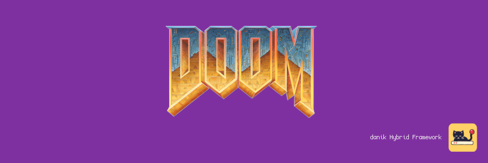
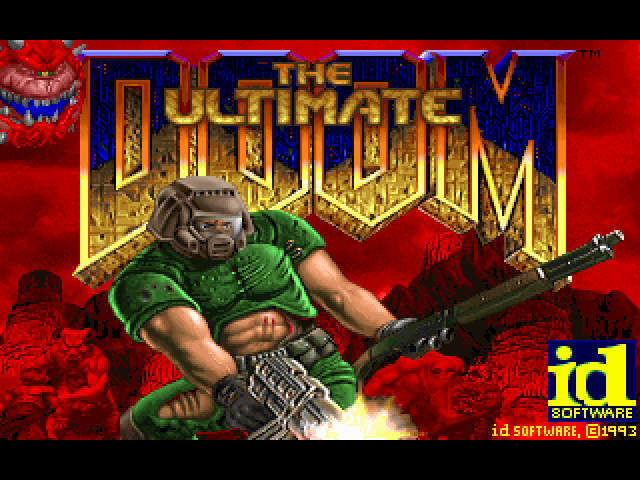
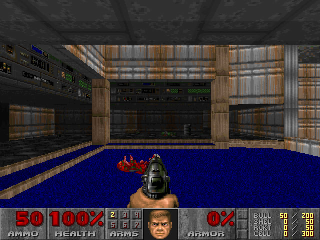

# CrispyDoom for MiSTer

Doom, Doom II, Final Doom, their expansions, Heretic, Hexen and Strife on [MiSTer FPGA](https://github.com/MiSTer-devel/Main_MiSTer/wiki) as a hybrid port.

The game itself is [Crispy Doom](https://github.com/fabiangreffrath/crispy-doom), the source port by Fabian Greffrath that stays close to the original Doom (it is based on [Chocolate Doom](https://www.chocolate-doom.org)) and lifts its limits, and for Heretic, Hexen and Strife its Crispy Heretic, Crispy Hexen and Crispy Strife. It runs on the MiSTer's ARM CPU. The CrispyDoom FPGA core provides native 15kHz video (CRT, VGA and HDMI) at 320x200, 640x200, 320x240 or 640x240, 44.1kHz audio with the music on an OPL2 (YM3812) FM chip in the core, and keyboard, mouse and gamepad input. The two halves talk through shared DDR3 memory.

> **Beta.** Expect rough edges and please report problems in the issues.
>
> **Disclaimer:** AI is being extensively used to speed up development, but the project is well-maintained and supported.

  
  

## Requirements

- **danik_hybrid_ports**, the launcher: run it **once** from the MiSTer's `Scripts` menu ([The launcher](#the-launcher)). Without it the core says "Game not running".
- **Game data**, which is not included: your own copy of Doom (or The Ultimate Doom), Doom II or Final Doom (TNT: Evilution and The Plutonia Experiment), their expansions (SIGIL, SIGIL II, No Rest for the Living, the Master Levels), Heretic, Hexen (and its expansion Deathkings of the Dark Citadel), Strife, or the shareware of Doom, Heretic or Strife. The game is in its `.WAD` file (the "IWAD"), from the original release or a later one (GOG, Steam).
- **Recommended:** a gamepad with two analog sticks and analog triggers, like an Xbox or PlayStation controller. A gamepad without them works but is not recommended. The game can also be played with a keyboard and mouse.

## Installation

With `update_all` (Downloader 2.4 or newer, which update_all keeps up to date):

1. Copy [`downloader_danik_hybrid_ports.ini`](https://raw.githubusercontent.com/ItsDanik/Hybrid_MiSTer/main/launcher/downloader_danik_hybrid_ports.ini) to the root of your SD card (`/media/fat`).
2. Run `update_all`. That installs the launcher, **danik_hybrid_ports**, in `Scripts`.
3. Run **danik_hybrid_ports** from the `Scripts` menu, tick the games you want and press *X: Apply*. They are installed, and update_all keeps them up to date.
4. Copy **everything** in your games' folders to `/media/fat/games/dnk/CrispyDoom/`, all the files as they are (files the port does not use do no harm). Each game is known by its IWAD:

   | Game | File |
   |---|---|
   | Doom, The Ultimate Doom | `DOOM.WAD` |
   | Doom shareware | `DOOM1.WAD` |
   | SIGIL | `SIGIL_v1_21.wad` (or `SIGIL_V1_23.wad`, `SIGIL_V1_23_REG.wad`, `SIGIL_v1_2.wad`, `SIGIL.wad`) and the `DOOM.WAD` of The Ultimate Doom (the one with episode 4) |
   | SIGIL II | `SIGIL_II_V1_0.WAD` (or `SIGIL_II_MP3_V1_0.WAD`) and the `DOOM.WAD` of The Ultimate Doom |
   | Doom II | `DOOM2.WAD` |
   | No Rest for the Living | `NERVE.WAD` and `DOOM2.WAD` |
   | Master Levels | `MASTERLEVELS.WAD` (or the 20 WADs of the Master Levels CD: `ATTACK.WAD`, `CANYON.WAD` and so on) and `DOOM2.WAD` |
   | TNT: Evilution | `TNT.WAD`, and `TNT31.WAD` where your copy has it (id's fix of MAP31's yellow key), which is then loaded as well |
   | The Plutonia Experiment | `PLUTONIA.WAD` |
   | Heretic | `HERETIC.WAD` (shareware: `HERETIC1.WAD`) |
   | Hexen | `HEXEN.WAD` |
   | Deathkings of the Dark Citadel | `HEXDD.WAD` and the `HEXEN.WAD` of Hexen 1.1 |
   | Strife | `STRIFE1.WAD` and `VOICES.WAD` (the voices; Strife plays without them) (shareware: `STRIFE0.WAD`) |
5. Load the game from the `Other` menu, e.g. **dnk-Doom**, or from the `Hybrid Ports` folder if you moved the games there in the launcher.

> [!NOTE]
> The game data can go on a USB drive instead, into the same folder there (`/media/usb0/games/dnk/CrispyDoom/`): the game looks for it there first, and then keeps its settings and saved games there as well. Everything else stays on the SD card.

Each expansion has its own menu entry: it starts at its own levels (New Game goes straight to the skill), with its own saved games (`savegames/sigil/` and so on), and the expansions Crispy Doom would otherwise load next to Doom II by itself are left to their entries. The menu entries of Doom, Heretic and Strife start the shareware when the full game is not there. When a game's files are missing, the core says which file to copy where. Each game keeps its own OSD settings and button mappings. The core file itself (`_Other/dnk/dnk-CrispyDoom_*.rbf`, or from *Recent*) lists the games that are there to pick from; quitting a game then returns to the list. The game's log is in `/media/fat/logs/dnk/CrispyDoom/crispydoom.log`, its settings in `games/dnk/CrispyDoom/default.cfg` and `crispy-doom.cfg`, saved games in `games/dnk/CrispyDoom/savegames/<IWAD>/` (on the USB drive, if the game data is there). Heretic's are `heretic.cfg`, `crispy-heretic.cfg` and `hticsav*.hsg` in the same folder, Hexen's `hexen.cfg`, `crispy-hexen.cfg` and `savegames/hexen.wad/` (Deathkings' `savegames/hexdd/`), Strife's `strife.cfg`, `crispy-strife.cfg` and `savegames/strife1.wad/`.

## The launcher

**danik_hybrid_ports** is what turns a menu entry into a running game. Once you've run it from the `Scripts` menu, it starts with the MiSTer, watches which core is loaded, and starts the game whenever a hybrid port's menu entry is loaded. It serves all our hybrid ports at once and updates itself through `update_all`.

Run it from the `Scripts` menu again whenever you want to change something. Its screen has:

- **Launcher**: on or off. Off, the ports' games no longer start (the core says "Game not running"), until you turn it on again.
- **Menu entries**: where the games appear in the MiSTer menu:
  - **Other, as dnk-\<Title\>**: each game in the `Other` menu, e.g. **dnk-Doom** (the default).
  - **Other/Hybrid Ports**: all of them in a *Hybrid Ports* folder in `Other`, without the `dnk-` in front.
  - **Main menu/Hybrid Ports**: a *Hybrid Ports* folder of its own in the main menu, next to `Arcade`, `Console` and `Other`.

  Moving them keeps each game's settings and button mappings. Favourites, recent lists and Zaparoo tags that point at the old place have to be made again.
- **The ports and their games**, a tickbox each. Tick what you want, untick what you don't.

*X: Apply* installs what is ticked and removes what is not, through Downloader, and moves the menu entries if you chose another place. When a port is removed, your game data, saved games and settings stay, and ticking it again brings it back as it was.

## OSD options

| Option | |
|---|---|
| Aspect ratio, Scale, Scandoubler Fx, Stereo Mix | as in other cores |
| FPS Counter | shows the pictures per second in the top left corner |
| HDMI Only | **Yes** if no CRT is connected: resolutions of 640x400 and more are then progressive instead of interlaced, and so is the core's own screen before the game, which moves at 60 pictures a second for a CRT and shows fine lines on HDMI without it. The analog output is switched off while one is shown, so that a 15kHz screen can never get such a signal. CrispyDoom has no such resolution, so nothing changes in the game. Not needed with `forced_scandoubler=1` (VGA monitor); not there with `direct_video=1` |
| CRT Options | **Horizontal Size**: the picture's width **Horizontal Pos**: moves it left or right **Vertical Pos**: moves it up or down **HUD (Top)**: moves the messages 0 to 24 lines down from the top edge (default 0), at 240 lines **HUD (Bottom)**: lifts the status bar 0 to 24 lines off the bottom edge (default 0), at 240 lines  For a 15kHz screen: fits the picture to it and keeps the messages and the status bar out of the overscan. HDMI is not affected; not there with `forced_scandoubler=1` |
| Resolution | **320x240**: the view fills the whole screen (default) **640x240**: the same, twice the detail across **320x200**: as the original **640x200**: as the original, twice the detail across  Always at 15kHz. With 240 lines the status bar and the messages are drawn over the view at the HUD margins, and nothing is stretched; menus, title screens, the intermission and the finales stay at 200 lines, centred. Applies at once |
| FM Music | **FPGA**: the YM3812 chip in the core (default) **Software**: the chip worked out on the ARM  With *Music* on the FM chip. Applies at once, so the two can be compared while the music plays |
| Music | **MIDI**: General MIDI on the core's synthesizer, or on an MT32-pi when one is on (default) **FM chip**: on the FM chip, as the original  Each game keeps its own choice |
| SoundFont | **Default**: GeneralUser GS, which comes with the port **1 to 7**: your own `.sf2` files in `games/dnk/SoundFonts/`, in the order of their names, or as the MIDI Player core sets them  A SoundFont that is missing, damaged or too big (over 64 MB of samples) is said in the MiSTer's info box, and the music goes to the FM chip |
| MT32-pi | **On**: the music is played on the MT32-pi (default) **Off**: as without it **MT32-pi Synth**: SoundFont (default) or MT-32 (it needs the MT-32 ROMs on the Pi's card) **MT32-pi ROM**: MT-32 v1, MT-32 v2 or CM-32L **MT32-pi SoundFont**: Pi's own (default) or one of the first eight on its card, 0 to 7 **Reset Hanging Notes**: the Pi stops all its notes, the music goes on  Only there while an [MT32-pi](https://github.com/dwhinham/mt32-pi) answers on the MiSTer's user port. The game's *Music Volume* sets its level. Applies at once |
| Rumble | **On**: when you are hurt, fire, land from a fall, and in Hexen's earthquakes (default) **Off**: never  Every controller that can rumble does; not in demos |
| Turn Sensitivity, Look Sensitivity | **Turn Sensitivity**: how fast the right stick turns **Look Sensitivity**: how fast it looks up and down  100% (default) to 200% in steps of 25%, then 25% to 75%; 150% is the speed of the releases up to 20261023. Applies at once |
| Cheats | **God Mode** (IDDQD): nothing hurts you **No Clipping** (IDCLIP): through walls **Infinite Ammo**: firing uses none **Buddha**: never below 1% health **No Target**: the monsters do not notice you **Give All** (IDKFA): every weapon, full ammo, all keys and armor **Kill All Monsters**: every monster of the level dies **Next Level**: completes the level **Full Map** (IDDT): the whole automap, then its things, then off  In every game, with its own cheat where it has one. Strife's Next Level goes to the map with the next number, which can skip part of the story. Not in demos or multiplayer |
| Reset | starts the game again from its beginning, as the USER button does |
| Save Diagnostic Report | the last line: see [If something is wrong](#if-something-is-wrong) |

Crispy Doom's own options are in its menu, under *Options* and *Crispness*. Its uncapped frame rate is on: the game moves 35 times per second, as the original, and the pictures in between are drawn part of the way to the next move. High resolution, widescreen and vsync do nothing on the MiSTer: the core's resolutions are those of the OSD, and the picture always comes with the core's fields.

## Controls

- **Keyboard and mouse:**

| Key | Action |
|---|---|
| Arrows | move and turn |
| Ctrl | fire |
| Space | use (doors, switches) |
| Shift | run (held; Caps Lock: always run) |
| Alt + Left / Right, `,` / `.` | strafe |
| 1 to 7 | weapons |
| Tab | automap |
| Esc | menu |
| Mouse | turns; left button fires, right strafes, middle moves forward, the wheel changes weapon |

- **Gamepad** (default mapping):

| Button | Action |
|---|---|
| Left stick | move and strafe |
| Right stick | turn (and look up and down, with *Allow Free Look* on in Crispy's options) |
| D-pad | move and turn |
| A (Xbox B / PlayStation Circle) | run (held) |
| B (Xbox A / PlayStation Cross) | use (doors, switches) |
| X (Xbox Y / PlayStation Triangle) | previous weapon |
| Y (Xbox X / PlayStation Square) | next weapon |
| L (LB / L1) | strafe (held: the d-pad and the right stick strafe) |
| R (RB / R1), R2 | fire |
| L2 | run (held) |
| Select | automap |
| Start | Menu |

In Heretic, Hexen and Strife the d-pad is for the inventory, and the left stick moves:

| Button | Heretic | Hexen | Strife |
|---|---|---|---|
| D-pad Left / Right | choose an artifact | choose an artifact (`[` / `]`) | choose an item (`[` / `]`) |
| D-pad Down | use it | use it (Enter) | use it (Enter) |
| D-pad Up | fly up (with the Wings of Wrath) | fly up (with the Wings of Wrath) | the mission objectives, held (`W`), not in menus and dialogues |
| A (Xbox B / PlayStation Circle) | fly down (*Run* in the OSD) | fly down (*Run* in the OSD) | run (held) |
| L2 | run (held) | run (held) | run (held) |
| X (Xbox Y / PlayStation Triangle) | previous weapon | jump (`/`; *Prev Weapon* in the OSD) | jump (`A`; *Prev Weapon* in the OSD) |
| Y (Xbox X / PlayStation Square) | next weapon | goes round the weapons | goes round the weapons |
| Keyboard only | | | `K` the keys, `Z` the inventory |

Change the buttons in the OSD under *Define CrispyDoom buttons*. *Menu OK* and *Menu Back* there are only needed for a spare button without a game function. While the OSD is open, the game gets no input.

> [!WARNING]
> A button left without a name in *Define CrispyDoom buttons* does not reach the game at all, except L2/R2, L3/R3 and *Menu OK* / *Menu Back*. Name every button there, or leave the definition as it is. To go back to the default buttons, delete `config/inputs/CrispyDoom_*_input_*_v3.map` (each game has its own) on the SD card.

Strife asks for a name when a game starts (*Name your character*): an empty slot comes with **PLAYER 1** (2, 3...) filled in, so that *Menu OK* starts it; a keyboard can change it.

## If something is wrong

If the game stutters, the sound breaks up or something else is wrong, open the OSD while it happens and pick **Save Diagnostic Report**, the last line of the menu. The game keeps running; MiSTer's info box says the report is saved in `games/dnk/diagnostics/` on the SD card. Send that file (`CrispyDoom_<date>_<time>.zip`) with a few words on what went wrong.

The report has the setup (versions, the video and audio lines of `MiSTer.ini`, the OSD settings), how the last 60 seconds went, the game's log and a screenshot. Nothing else: no network settings, addresses, saved games or lists of your files.

## Building

How the port works, how to build it and notes for development: [NOTES.md](NOTES.md).

## Support

If you enjoy this project, you can support my work on [Patreon](https://www.patreon.com/itsdanik).

## Credits

- **[Crispy Doom](https://github.com/fabiangreffrath/crispy-doom)** (and Crispy Heretic, Hexen and Strife) by Fabian Greffrath and contributors, based on **[Chocolate Doom](https://www.chocolate-doom.org)** by Simon Howard and contributors (Chocolate Strife: Strife reconstructed by James Haley and Samuel Villarreal), and on the Doom, Heretic and Hexen source code released by id Software and Raven Software.
- **[GeneralUser GS](https://www.schristiancollins.com/generaluser.php)** by S. Christian Collins: the SoundFont of the core's MIDI synthesizer, which comes with the port, its licence next to it.
- **[JTOPL](https://github.com/jotego/jtopl)** by Jose Tejada (jotego): the FM chip in the core. **[Nuked OPL3](https://github.com/nukeykt/Nuked-OPL3)** by nukeykt: the software one.
- **[SDL](https://libsdl.org)** by Sam Lantinga and contributors.
- **[MiSTer](https://github.com/MiSTer-devel)** by Sorgelig and the MiSTer-devel contributors: the framework and Template_MiSTer.
- **[MiSTer Frontier](https://github.com/MiSTerOrganize/MiSTer_Frontier)** by MiSTer Organize: thank you for the inspiration. Hybrid cores on the MiSTer, and the way their game is launched (a daemon that watches the loaded core and runs a script from its games folder), were inspired by MiSTer Frontier.

This project and its maintainers are in no way associated with or endorsed by id Software, Raven Software, Rogue Entertainment, Nightdive Studios, Bethesda Softworks or ZeniMax Media. It does not include any game data.

## License

The top-level scripts, tools and documentation are licensed under the [GPL-3.0](LICENSE). The components keep their own licenses: the part of the shared framework the game is linked with (`hybrid/hps/`) is GPL-2.0-or-later, the rest of `hybrid/` GPL-3.0 except where its files say otherwise, Crispy Doom (`crispydoom/`) is GPL-2.0-or-later, SDL and the SDL drivers in `hybrid/sdl2` are zlib, the FPGA core and the MiSTer framework are GPL-2.0 (`core/LICENSE`, with the core's own sources GPL-2.0-or-later).
